# Architecture

Source: [`architecture.mmd`](architecture.mmd) (Mermaid).

## Data flow

1. **Collectors** (`:collectors`, `:probes`) implement `Collector` (`core/runtime/Contracts.kt`). Each returns a cold `Flow<Sample>` that registers platform callbacks on collection and unregisters on cancellation. They are contributed to a Hilt `Set<Collector>`, so adding a collector touches no other module.
2. **RunService** (`:app`) owns the run lifecycle. It launches every collector in its own supervised job (exponential backoff, watchdog on silence) and funnels all samples through one serialized `onSample`:
   `sink.emit(sample)` → `LiveAggregator.onSample` → `EventEngine.onSample` → events go back into the sink and the aggregator.
3. **Single writer** (`:storage` `BatchingSampleWriter`): bounded channel, one consumer coroutine on one thread, flush every 1 s or 200 rows in one transaction with cached prepared statements. WAL journal.
4. **Schema**: `core/schema/Schema.kt` is the single source of truth. Room manages only `runs`; every sample table is created from the canonical DDL, so the Android DB, the exported `run.sqlite` and the iOS DB share identical columns. `SchemaTest` locks the shared contract; `docs/SCHEMA.md` is generated from it.
5. **Live UI**: `LiveAggregator` folds samples into an immutable `LiveSnapshot`, published at 1 Hz through `RunController.live`. The notification is a 2 s projection of the same snapshot. `RunSignals` feeds back to probes (re-test throughput on RAT change; tighten latency interval while degraded).
6. **Replay** reads per-table lists from `RunRepository` and can re-run `EventEngine` with edited thresholds. The engine has no Android dependency and no wall-clock reads, so live and replay results are identical.
7. **Export**: `ATTACH` a fresh canonical `run.sqlite`, `INSERT … SELECT` the run's rows, then `core/export/Bundle.write` emits CSVs, GeoJSON and a SHA-256 manifest. Import (`Bundle.read`) verifies checksums and ignores unknown tables/columns.

## Timestamps

Every row: `t_utc_ms` (wall), `t_mono_ns` (`elapsedRealtimeNanos`), plus `gps_time_ms` on fixes. All windowed rules use monotonic time; cross-device alignment uses GNSS time (`core/pairing/Pairing.kt`).

## Testing

| layer | where | runs on |
|---|---|---|
| rules + causes on synthetic timelines | `events/src/test` | any JVM (`tools/verify-jvm.sh`) |
| CellInfo parsing (LTE/NR/WCDMA/GSM fixtures) | `core/src/test` + `fixtures/cellinfo/*.json` | any JVM |
| schema contract, codec round-trip, export integrity + tamper detection, alignment, completeness | `core/src/test` | any JVM |
| Room schema parity, writer batching, canonical migrations | `storage/src/test` (Robolectric), `storage/src/androidTest` | JVM / device |
| probe timing + error classification | `probes/src/test` (MockWebServer) | JVM |
| service lifecycle (start → record → pause → resume → stop) in Simulate mode | `app/src/androidTest` | device |
